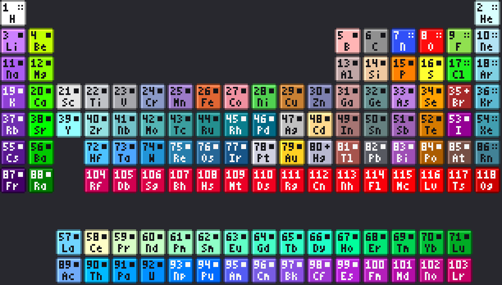
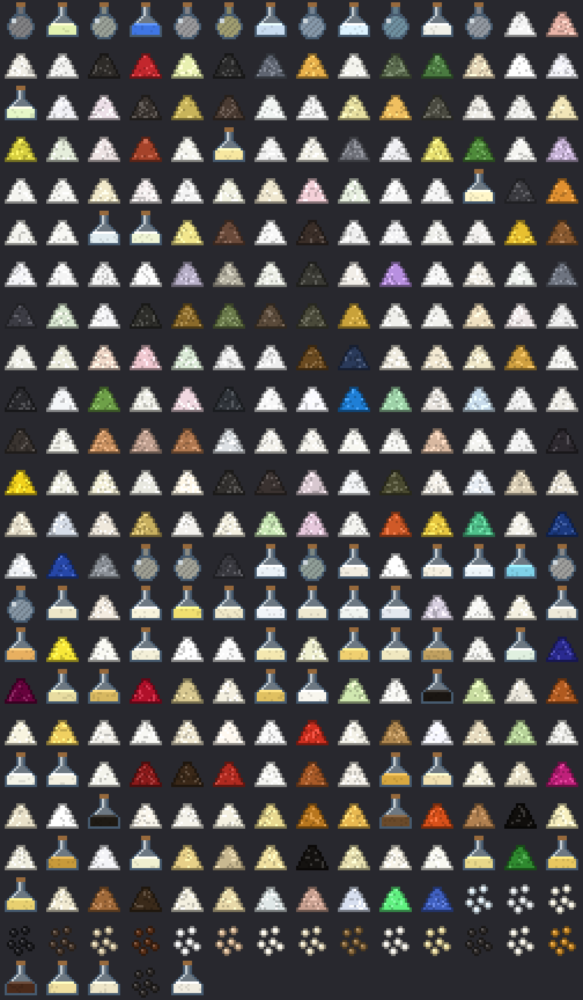
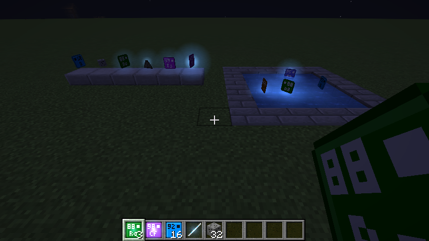
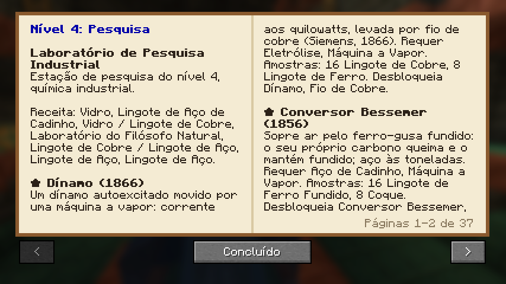
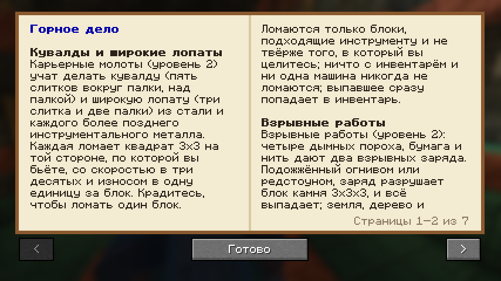

# Elementar

Elementar is the mod's official name since 3.48.0. Its internal mod id stays
`periodic_elements` (and the Java package `com.periodicelements`), so worlds,
items, blocks and research saved with earlier versions keep working.

A Fabric mod for Minecraft 1.21.1 that adds all 118 chemical elements as items.
Each element has its own periodic-table tile texture (atomic number, symbol, and a
state marker), an English name, and a tooltip with its symbol, atomic number,
category, and state at room temperature. They all live in a "Periodic Table"
creative tab, in atomic-number order.

It also adds 73 substances made from those elements, ordered from simple to
complex and chosen for their use in common industrial and agricultural processes:
from water, carbon dioxide and ammonia, through acids, salts and fertilizers
(urea, ammonium nitrate, DAP), to organic chemicals, herbicides, sugars and
polymers. They live in a "Substances" creative tab. Each tooltip shows the
formula, complexity tier, sector (industry, agriculture, or both), main use,
and state.

Complexity tiers: 1 simple molecules, 2 simple inorganic compounds, 3 salts and
minerals, 4 organic compounds, 5 complex organics, 6 polymers. Within a tier,
substances are sorted by the number of atoms in one formula unit.

## Tech levels and block compositions

Every element and substance has a historical tech level, from 0 (Stone Age) to
7 (Accelerator age), based on when it was first isolated or made. Element
tooltips also show the year it was isolated.

`data/compositions.csv` gives about 90 natural vanilla blocks and 25 items a
real-world composition (rocks as oxide analyses, wood and plants as cellulose,
lignin, and water). Units: 1 block = 1000 units, 1 ingot/gem/dust = 111.1,
1 nugget = 12.35, 1 bucket = 1000. Ore blocks hold exactly what they drop, inside
their host rock. A row can reuse another row's makeup (`block:minecraft:stone:75`,
`item:minecraft:raw_iron:11.1`), and the generator flattens it.

`data/rarity.csv` corrects elements the game makes far more common than real life
(gold, mercury via redstone, beryllium via emerald). Their yield is scaled by
(real abundance / in-game abundance, relative to iron) ^ 0.25, and the removed units
become gangue (ordinary rock). A gold block therefore yields about 28 units of gold.
Common elements such as aluminium get no correction: they are gated by tech level and
energy instead. Hovering over a block or item shows what it yields; hold Shift for all parts.
Fictional blocks get a proposed real analogue, marked "Proposed" in the CSV
(for example redstone as cinnabar, glowstone as a zinc sulfide phosphor).

## Research, treatises and the first machines

Research is per player and saved with the world. A player's tech level is the highest level whose
**key** projects (and those of every level below) are finished; optional projects improve the current
era. Level 0 needs no research.

- **Research stations** (blocks): the Potter's and Smith's Workshop researches level 1 projects, the
  Alchemist's Laboratory level 2. Put a project's samples in the station's 9 slots, pick the project in
  the list (star = key project, hover for details) and press Research. It takes 20 seconds per level;
  the player who started it gets the project. A station of level N can only be placed by a player at
  tech level N-1.
- **Treatises**: press Treatise at a station to write down everything you know. Cost: 1 leather, plus
  1 paper and 1 ink (carbon ink or an ink sac) per project, taken from the station's slots. Needs the
  Writing and Ink project. Using the treatise teaches the reader all of it at once and consumes it; the
  writer keeps their knowledge. Later eras' treatise forms (printed book ... laptop) come with their
  stations.
- `/research` shows your level and projects; operators can `/research grant|revoke <players> <project|all|level:N>`.

The machines run the reactions in `data/reactions.csv` on the **composition** of what goes in
(`data/compositions.csv`), with real temperatures, pressure and energy:

| Machine | Unlocked by | Does | Needs |
|---|---|---|---|
| Charcoal Pit | nothing (level 0) | logs to charcoal (22% of cellulose, 40% of lignin) | 400-700 °C, burns wood |
| Lime Kiln | Lime Burning | calcite / limestone to quicklime, CO2 vented | 900-1200 °C, +260 kJ per 100 units |
| Lime Kiln, cool | Green Vitriol | roasts pyrite gently into green vitriol (iron sulfate) | 400-650 °C: burn wood, not charcoal |
| Smelting Furnace | Copper Smelting | roasts chalcopyrite and pyrite (gives off heat), reduces CuO to copper ingots and cassiterite to tin with charcoal, melts out native gold | 1085 °C+ for copper, 900 °C+ for tin, 1064 °C+ for gold |
| Smelting Furnace | Lead Smelting | roasts galena to litharge and reduces it to lead | 700 °C+ |
| Smelting Furnace | Mercury from Cinnabar | roasts redstone (as cinnabar) and condenses the mercury | 400 °C+ |
| Bloomery | Iron Smelting | reduces hematite and magnetite to iron ingots with charcoal | 1150 °C+, so it needs Bellows |

Copper and iron come out as vanilla ingots (gold already did). A shapeless recipe turns a copper, iron or
gold ingot into the element item and back, 1 to 1.

How a machine works: one input item is broken into its composition (1 unit = 1 g; 1 block = 1000 units)
and every reaction the owner (the player who placed it) has researched runs on it while the machine is
inside that reaction's temperature range. Products used by a later reaction stay in, so roasting feeds
reduction. Products come out as items (one element or substance item = 111.1 units; charcoal as vanilla
charcoal), unused material as slag (or wood ash), gases are vented. Mass balance is exact apart from
vented gases and the air a roast uses.

Heat is simulated: fuel gives 4 kJ per tick until its energy (from `data/fuels.csv`, e.g. charcoal
3,330 kJ) is spent, the machine loses heat in proportion to how hot it is, and reactions draw (or give
off) their energy, so a loaded kiln cools and waits for the fire to catch up. A fuel can't push the
machine past its flame temperature (wood 650 °C, charcoal and coal 1,100 °C), plus 250 °C once the owner
knows Bellows. Charcoal and coal in the fuel slot double as the reducing agent. Machine sizes and losses
are in `data/machines.csv`.

Vanilla furnaces and blast furnaces no longer smelt iron, copper or gold ores (or raw iron, copper and
gold): those recipes are switched off with Fabric load conditions, so metals come from the machines.
Furnaces still cook food, glass, bricks and everything else.

Yields follow the compositions: 9 raw iron give 5 iron ingots, about 4 raw copper give 1 copper ingot
(copper has no rarity correction), and gold stays rare: the smelting furnace melts native gold out of raw
gold at 1,064 °C, about 14 units per raw gold block, so 8 raw gold blocks make 1 gold ingot. Refined metal
(ingots, nuggets, metal blocks) is not rarity-corrected a second time, so a gold block melts back into 9
ingots. About 2 raw cassiterite give 1 tin (tin has no rarity correction, like copper), 10 raw galena give
1 lead (rarity-corrected), and 35 redstone give 1 mercury (Mercury Amalgamation asks for just 1).

## Ores (v0.4.0)

Five new minerals, so every research sample has a source in survival. They generate in new worlds and in
newly explored chunks of existing worlds.

| Ore | Where | Drops | Tool |
|---|---|---|---|
| Cassiterite Ore (stone, deepslate) | Overworld, Y -16 to 80, extra veins in mountains up to Y 160 | 1-3 Raw Cassiterite (tin) | stone pickaxe |
| Galena Ore (stone, deepslate) | Overworld, Y -32 to 48 | 1-3 Raw Galena (lead) | stone pickaxe |
| Sphalerite Ore (stone, deepslate) | Overworld, Y -16 to 64 | 1-2 Zinc Sulfide | stone pickaxe |
| Nether Sulfur Ore | Nether, Y 10 to 117, extra in basalt deltas | 2-4 Sulfur | any pickaxe |
| Deepslate Sulfur Ore | Overworld, Y -64 to -40 (lava-lake depth) | 2-4 Sulfur | any pickaxe |
| Saltpetre Crust | sandstone in deserts and badlands (Y 30-100), dripstone caves | 1-3 Potassium Nitrate | any pickaxe |

Fortune and Silk Touch work as on vanilla ores. Measured in a 128 x 128 area of a test world: cassiterite
about half as common as iron ore, galena 0.45 times. `data/rarity.csv` corrects lead the same way it corrects gold; tin is left rich
(v0.4.1) so bronze is within reach early. Vein sizes, heights and biomes are in `tools/ores.py`. The generator now refuses to
build if a research project asks for a mod item that no ore or machine produces.

Tests: `./gradlew runGametest` runs automated game tests that drive each machine through real inputs
and check yields against the stoichiometry, plus research gating and treatise transfer.
`./gradlew runScreenshots` (needs a display or `xvfb-run`) opens `run/saves/smoke` and screenshots the
screens and the new ores.

## How it is data-driven

`data/elements.csv` is the source of truth for elements (number, symbol, name,
state, category, color), and `data/substances.csv` for substances (tier, id,
name, formula, state, sector, color, use). The generator checks that every
formula only uses real element symbols and stores each substance's atom counts,
ready for crafting recipes later. Run

    python3 tools/generate.py

to regenerate everything that depends on it: the runtime table the mod reads
(`src/main/resources/periodic_elements/elements.json`), the item models, the
16x16 textures (tiles for elements; flasks, gas cylinders, powder piles, and
pellets for substances), the English translations, the mod icon, and the preview images.
The Java code registers one item per row of each table, so nothing per element is written by hand.
The generator needs Python 3 and Pillow (`pip install pillow`).

State markers in the top-right of each tile: filled square = solid,
plus = liquid, four dots = gas, squiggle = unknown (superheavy elements 104-118).

## Building

Requires Java 21.

    ./gradlew build          # jar ends up in build/libs/elementar-<version>.jar
    ./gradlew runClient      # launches Minecraft with the mod for testing

Tested 2026-11-01 (v0.4.1): `./gradlew build` succeeds with Gradle 8.10.2, Loom 1.7, Java 21;
`./gradlew runGametest` passes all 21 tests; `./gradlew runServer` starts a 1.21.1 dedicated server
with no mod errors, and all nine ores generate in a fresh world.

If Maven Central answers 429 Too Many Requests (common on shared cloud IPs), put a
user-level init script in `~/.gradle/init.d/` that points `repo.maven.apache.org`
at Google's mirror, `https://maven-central.storage-download.googleapis.com/maven2/`.

Install the jar in `.minecraft/mods` alongside Fabric Loader and Fabric API for 1.21.1.

To target another Minecraft version, change the versions in `gradle.properties`
(see https://fabricmc.net/develop). Versions 1.21.2 and later changed how items
are registered, so the Java code would need small updates.

## 0.5.0: level 2 finished, alloys and gear

Ten new machines run the rest of the Bronze Age and Alchemy era: Crucible (bronze, brass, type metal), Cupel
Hearth (silver from galena and gold ore), Alembic (wood distillation, oil of vitriol, aqua fortis), Crystallizer
(saltpetre from nitre earth), Charcoal Blast Furnace (cast iron), Cementation Furnace (blister steel), Zinc Retort,
Amalgamation Pan (gold and silver with mercury), Phosphorus Retort (phosphorus from bones) and Reverberatory Furnace
(arsenic, antimony, bismuth, cobalt). Three new ores: cobaltite, stibnite and arsenopyrite.

Machines have a **reagent slot** for a reaction's second ingredient (tin for bronze, water for oil of vitriol,
sulfuric acid for aqua fortis, mercury for amalgamation). The fire is **tended**: once the charge is as hot as its
reactions allow, the draft is closed and the fuel is banked until it cools, so a low-temperature process isn't
overheated.

Gear is gated by process: bronze tools and armor need Crucible bronze, blister steel tools and armor need the
Cementation Furnace. The Hand Cannon (Black Powder research) fires a lead ball with one black powder.

`tools/generate.py` now refuses to build if an element at or below the released tech level (2) has no source.

## 0.5.1: no empty projects in levels 1 and 2

Every research project in levels 1 and 2 now unlocks something real, and `tools/generate.py` refuses to build if an
unlock of a released level names a machine, reaction, item or recipe that doesn't exist.

Six new machines: Pottery Kiln (clay into brick), Salt Pan (seawater into salt and bittern, no fuel), Fermentation
Barrel (sugar into ethanol, no fuel), Vinegar Vat (ethanol into vinegar), Glass Furnace (sand with wood ash into
forest glass) and Porcelain Kiln (kaolin and quartz at 1300 °C). The Alembic also makes spirit of salt (hydrochloric
acid) and dissolves gold in aqua regia. An empty bucket filled in an ocean or beach biome gives a Bucket of Seawater.

New recipes: lime slaking, bark tanning, leavened bread, aqua regia, iron-gall ink, and the Magnifying Lens, which
shows the composition of the block you look at. Wrought iron tools and armor (300 durability) replace vanilla's iron
recipes. With Printing Press research and type metal in the station, a treatise is printed: two copies for 2 leather
and one paper and ink per two projects. Ethanol burns as fuel.

## 0.6.0: level 3, the Chemical Revolution

A third research station, the Natural Philosopher's Laboratory, holds 19 projects (7 key). Every element up to
level 3 now has a real process: H, Li, Be, B, N, O, Na, Mg, Cl, K, Ca, Se, Br, Sr, Cd, I, Ba and Pt, plus uranium
oxide. Elements the plan places later (Al, Si, Ti, Cr, Mn, Ni, Y, Zr, Nb, Mo, Rh, Pd, Te, Ce, Ta, W, Os, Ir, Th, U
metal) moved to levels 4 to 6, and `RELEASED_LEVEL` is now 3.

Seven machines (Coke Oven, Huntsman Crucible Furnace, Pneumatic Trough, Electrolysis Cell, Digestion Vat, Reduction
Crucible, Lead Chamber) and the first **power blocks**: the Voltaic Pile turns zinc into current (361 kJ per zinc,
up to 2 kJ per tick, zinc oxide back) for the Electrolysis Cell next to it, which takes its electrolysis energy from
the current and melts its salt with the rest; the Steam Engine burns fuel with a water bucket and blows any furnace
with Bellows next to it 200 °C hotter. Coke burns at 1600 °C, which the Huntsman furnace needs for crucible steel.

Four ores (barite with celestine, spodumene, borax crust with sylvite, pitchblende); sphalerite now drops Raw
Sphalerite with 3% greenockite (cadmium); raw gold holds 2% platinum grains; kelp holds iodine and bittern bromine.
Crucible steel tools and armor (900 durability, mines like diamond) and the Flintlock Musket.

## 0.6.1: the lens shows what you know

The Magnifying Lens now breaks the block into elements by mass and names only the elements you know: the Stone Age
ones (carbon, copper, gold, silver, sulfur) and any element made by a research project you have finished. Everything
else is summed in one line as "other". Raw sphalerite shows sulfur and a large "other" until Zinc Distillation, then
zinc appears; cadmium stays in "other" until its own project.

## 0.7.0: level 4, the Industrial Revolution

A fourth research station, the Industrial Laboratory, holds 31 projects (7 key: Dynamo, Bessemer Converter,
Chlor-Alkali Process, Liquid Air, Spectroscopy, Electrolytic Refining, Hall-Heroult Process). Every element up to
level 4 now has a real process: He, F, Ne, Al, Ar, V, Mn, Ni, Ga, Ge, Kr, Rb, Ru, Rh, Pd, In, Te, Xe, Cs, W, Os, Ir,
Tl, Po, Rn, Ra, Ac and Th. `RELEASED_LEVEL` is now 4.

The **Dynamo** turns half a Steam Engine's work into current (12 kJ per tick), and **Copper Wire** carries it up to
64 blocks to electric machines. Eleven new machines: Bessemer Converter, Bayer Digester, Hall-Heroult Cell,
Chlor-Alkali Cell, Solvay Tower, Contact Converter, Air Liquefier (draws in air by itself), Spectroscope Bench,
Electrolytic Refinery, Mond Reactor and Moissan Cell. Seven ores: bauxite, pyrolusite, pentlandite (deepslate),
wolframite, vanadinite, fluorite and heavy mineral sand.

**Radiation** (`com.periodicelements.radiation`): real gamma dose rates per gram from `radiation.json`, dose from
carried items and nearby blocks and containers, acute radiation syndrome effects by unrepaired dose, repair with a
72-hour half-life in real time, a lifetime dose statistic, the Electroscope, and the gamerule `periodicRadiation`
(realistic, milder, off). Manganese steel, tungsten steel and aluminium gear, and the Breech-Loading Rifle.

Balance: bittern holds 40% magnesium bromide (twice the bromine), and the Electrolysis Cell loses less heat (2 salt
take about 11 zinc instead of 18).

## 0.8.0: level 5, alloys, nitrogen and rare earths

A fifth research station, the University Research Institute, holds 21 projects (6 key: Electric Arc Furnace,
Haber-Bosch Process, Froth Flotation, Stainless Steel, Rare Earths, Crystal Bar Process). Every element up to level 5
now has a real process: Si, Cr, Zr, Nb, Mo, La, Ce, Pr, Nd, Hf, Ta, Re, Fr and Pa. Technetium and astatine moved to
level 6 with the reactor and cyclotron that make them. `RELEASED_LEVEL` is now 5.

Seven machines: Electric Arc Furnace (electric, to 3000 °C), High-Pressure Reactor (Haber), Ostwald Converter,
Flotation Cell, Sintering Furnace, Fractional Crystallizer and Van Arkel Reactor. Three ores: chromite (deepslate),
molybdenite (with rhenium) and coltan. Heavy mineral concentrate now gives zirconium, hafnium and the rare earths.
Francium exists only as a trace in a caesium precipitate, like radon in its seed.

Gear: stainless steel tools and armor, high-speed steel, cemented carbide and beryllium copper tools. The Geiger
Counter reads radiation by itself while held and clicks faster as the dose rate rises.

## 0.8.1: more mercury

Redstone (the mod's cinnabar) is now 10% mercury sulfide instead of 3.4%: about 12 redstone per mercury instead of
34. `compositions.py` has a `FACTOR_FLOOR` for elements the game needs more of than the rarity formula gives.

## 0.9.0: level 6, first half (chemistry)

Level 6 ships in two halves; this is the non-nuclear one. A sixth station, the National Laboratory, holds 13 projects
(5 key: Kroll Process, Ion Exchange, Single Crystals, Synthetic Diamond, Uranium Metal). New elements with a real
process: Ti, Sc, Y, Sm, Eu, Gd, Tb, Dy, Ho, Er, Tm, Yb, Lu and uranium metal. The twelve nuclear elements (Tc, Pm,
At, Np to Md) are listed in `NUCLEAR_PENDING` in `generate.py` and come in 0.9.5 with the reactor, hot cell and
cyclotron.

Six machines: Chlorinator, Kroll Reactor, Ion-Exchange Column, Crystal Puller, Zone Refiner and Diamond Press, plus
the Solar Panel (1 kJ per tick by day under open sky). Heavy mineral concentrate now holds 10% xenotime for yttrium
and the heavy rare earths. Gear: titanium alloy (Ti-6Al-4V) tools and armor, diamond-tipped tools.

## 0.9.5: level 6, second half (nuclear)

Ten more National Laboratory projects (3 key: Isotope Separation, Nuclear Reactor, Reprocessing) finish level 6:
every element from 1 to 101 has a source. Uranium hexafluoride is enriched in the Enrichment Cascade (7 natural to
1 enriched and 6 depleted); enriched UF6 becomes uranium dioxide, fuel pellets and Zircaloy-clad fuel rods. The
Nuclear Reactor (a power block, kind `reactor`) burns a rod for three game days at 30 kJ per tick while water touches
it, and irradiates target items in its slots (`irradiation` in `POWER` in `machines.py`). The Hot Cell reprocesses
spent rods (PUREX) into U, Pu, Np, Am, Cm, Pm and Tc, and the Cyclotron makes milligram samples of At, Bk, Cf and Md.

Decay: `decay.json` (from `DECAY` and `ISOTOPES` in `generate.py`) lists the items that decay on the game clock
(`Decay.java`; one game day is 24 hours) and the isotope each radioactive element stands for. The Hot Cell and the
reactor shield their contents (`SHIELDED`). Tungsten carbide and depleted uranium penetrator arrows fire from bows.

## 1.0.0: level 7, the last elements

A seventh station, the International Research Centre, holds 11 projects (3 key: Superconducting Magnets, Integrated
Circuit, Heavy-Ion Accelerator). Elements 102 to 118 come from the Heavy-Ion Accelerator as detection records
(`TRACE_CARRIERS` in `generate.py`), each from its historical target and beam; calcium-48 comes from the Calutron.
New parts: niobium-titanium wire, integrated circuits, gallium arsenide wafers, neodymium magnets (for the Wind
Turbine power block, kind `wind`) and composite plates for composite armour (armour only, slightly better than
netherite). All 118 elements now have a source.

## 1.1.0: the last uses

Radioisotope Generator (Pu-238 pellets from neptunium irradiated in the reactor; power kind `rtg`), Smoke Detector
block (`SmokeDetectorBlock`, redstone on fire within 4 blocks), Lithium-Ion Battery (power kind `battery`, charges
from the sources it is wired to), Fibre Communicator and Element Analyzer (`ResearchedToolItem`).

## 1.2.0: petrochemicals

Oil Shale ore (raw shale is 40% kerogen, retorted in the Alembic) and coal liquefaction in the High-Pressure Reactor
give crude oil and its fractions. New machines: Oil Refinery Still (its residue is bitumen) and Cracking Unit (thermal
cracking, then catalytic reforming). New power kind `generator` (Diesel Generator). Polyethylene, PVC, nylon, and a
four-step aramid route from p-xylene and benzene that replaces the ethanol shortcut. Blocks: Asphalt (velocity
multiplier 1.1), Insulated Cable (a quarter of the wire reach per block). Items: Parachute (`ParachuteItem`), and
kerosene rockets (firework rockets of flight 3, via `RESULT_COMPONENTS`).

## 1.3.0: isotope ratios

Every stable element's tooltip shows its natural isotopes (`tools/isotopes.py` NATURAL). Uranium (U-235),
plutonium (Pu-240), lithium (Li-6), boron (B-10), calcium (Ca-48) and hydrogen (H-2) items can carry their own
ratio in the `periodic_elements:isotope_ratio` component (absent = natural, rounded per element so items stack).
Machines mix ratios in the charge and keep them in the output buffers as `id#ratio`. Reactions can stamp a ratio,
make a Calutron separation pass (`separate`: odds times alpha for a cut, the rest depleted by mass balance) or
require a minimum enrichment (`minRatio`). Reactor-bred plutonium is stamped weapons grade (6% Pu-240).

## 1.4.0: isotope uses and the Field Guide

Uses for the isotopes 1.3.0 left idle: boron over 90% B-10 sinters into Boron Control Rods (a reactor holding one
stops burning while its store is full); lithium over 90% Li-6 in the reactor's slots becomes Tritium Vials
(`irradiationIf` in isotopes.json), which light Tritium Light blocks; heavy water (Enrichment Cascade, fed ice or
snow) lets Natural Uranium Fuel Rods burn. The Field Guide item opens a chaptered book generated by
`tools/guidebook.py` from the same data as the mod (guidebook.json); `./gradlew runGuideShots` screenshots it.

## 1.4.1: balance pass

The rare late-game ores (pitchblende, coltan) generate more often, including new veins in mountain granite and pegmatite, and the biome ores (bauxite, vanadinite, wolframite, spodumene) have more veins outside their home biomes. Lead lost its rarity correction, as tin did in 0.4.1. Raw gold, sphalerite, spent fuel, pitchblende residue and anode slime give more of their scarce elements. The Electrolysis Cell needs 1 platinum, not 2, and several research samples ask for less. Research samples can name alternatives (`a|b*8`), so Lime Burning also takes dripstone. The full list is in progression-and-recipes-1.4.1.md, and the reasons are in balance-review-1.3.0.md.

## 1.4.2: thicker heavy mineral sand

Beach and river heavy mineral sand veins come twice as often (24 per chunk, was 12). Measured in seed 4242: a beach chunk now gives about 1.1 raw concentrate per raw iron (was 0.5).

## 1.5.0: flasks, cylinders, the Compressor and the Storage Tank

Every liquid and gas item (elements and substances whose state is liquid or gas) now comes in a Glass Flask
(`recipeRemainder`): crafting, machines, furnace fuel, power blocks and research give the empty flask back.
Machines have a side panel with an empty-flask slot, an empty-cylinder slot and two upgrade slots; a machine
making a liquid or gas stops (`NEEDS_FLASKS`) until it has flasks. Each gas has a `<gas>_cylinder` item of 1000
units (nine flasks); with a Compressor in an upgrade slot (and Gas Compression researched) a machine fills Steel
Cylinders instead of flasks for its gases. Cylinders of fuel gases burn like nine flasks. The Storage Tank holds
16,000 units of one liquid or gas, by hand or by hopper (in from the top and sides, out from the bottom), and
gives a comparator signal. `tools/fluids.py` writes the cylinders and fluids.json.

## 1.6.0: machine upgrades

Six more upgrades for a machine's two upgrade slots (`machine/Upgrades.java`), each unlocked by its own project
("upgrade:<id>") and inactive until researched: Regenerator (fuel-fired heat loss halved), Refractory Lining
(fuel-fired limit +150 °C, shown in the screen's limit), Gas Recovery Hood (vented liquids and gases except steam go
into flasks or cylinders; never blocks the machine), Mechanical Stirrer (charge 1.5x faster for 25% more fuel or a
motor draw), Catalyst Bed (reactions over a solid catalyst 2x faster) and Output Pusher (products into an adjacent
chest, barrel or hopper, never into another machine). No pipes.

## 1.7.0: farm and fat

The first half of the organic chemistry plan (levels 1 to 3). Vanilla meat, hides, bones, eggs, milk, grain, seeds,
roots and berries now have compositions (fat, protein, starch, sugar, oil, water), so machines can take them.
Four machines: Soap Kettle (rendering, soap boiling, hard soap), Oil Press, Tanning Pit (four rotten flesh make one
leather in about 72,000 ticks) and Vulcanizer. New reactions also run in the Fermentation Barrel (mashing), Alembic
(ether), Crystallizer (alum), Coke Oven (ammonia water), Lead Chamber (sulfate of ammonia) and Digestion Vat
(superphosphate, starch sugar). Extraction reactions (feed `x` -> product `item:periodic_elements:x`) pass an
ingredient through unchanged, the way cryolite washing did.

`tools/farm.py` and `com.periodicelements.farm` add the rubber tree (wild only in the biome tag
`periodic_elements:rubber_tree_biomes`: jungle, sparse jungle, bamboo jungle; the sapling grows anywhere), the Tree
Tap (latex only in those biomes), tallow candles, the Clean effect (soap; removes Hunger), Fertilized Farmland
(superphosphate or ammonium sulfate on farmland: 1.5x growth and +1 crop for 8 harvests, kept in a PersistentState),
Sneakers and Rubber Wheels. The mod's first mixins (`periodic_elements.mixins.json`): sneakers make
`Entity.bypassesSteppingEffects` true, and a minecart tagged `pe_rubber_wheels` has 1.25x `getMaxSpeed`. Infection
is left for 1.8.0.

## 1.8.0: coal tar and dyes

The organic chemistry plan's second release (levels 2 to 4), 15 research projects. With Tar Distillation the Coke
Oven catches coal tar in flasks (`coal_tar_condensing`, before `coal_degassing_hydrogen`); the Tar Still cuts it
into benzene, phenol and anthracene with pitch as its residue (Tarmac block). Benzene nitration moved from level 7
to level 3 (project `nitrobenzene`). Dye Vat (Prussian blue, fuchsine, and turning dye substances into vanilla
dyes: compositions of 3.47 units make 32 dyes per flask), Autoclave (alizarin, Kolbe-Schmitt), aniline, picric
acid, nitroglycerin, cordite, aspirin, blue vitriol, pyrethrum. Vacuum Pump upgrade (`Upgrades.VACUUM_PUMP`):
reactions in boiling machines run as if 100 °C hotter, and the machine is held below its reactions' top.

`com.periodicelements.medicine`: Infection (stage 1 for a game day, then 70% recovery or Sepsis), the game rule
`periodicElementsInfection`, aspirin and the ether anaesthetic (an accessor mixin halves a zombie villager's
conversion timer); carbolic soap is in `#periodic_elements:soap`. Mining Charge (5x5x5, every block drops, stops
at blast resistance 1200, respects mobGriefing), Insect Spray, Bordeaux mixture (`Sprayed` PersistentState and
mixins on CropBlock, FlowableFluid and SweetBerryBushBlock), Cordite Cartridges in `HandCannonItem`.

## 1.9.0: industrial organics

The organic chemistry plan's third release (level 5), 13 research projects and the electric Prilling Tower.
Calcium carbide in the Electric Arc Furnace (coke as carbon), acetylene from carbide and water (Digestion Vat),
nitrolime in the Lime Kiln, formaldehyde in the Ostwald Converter, Bakelite in the Autoclave, urea in the
High-Pressure Reactor (carbon dioxide from a Gas Recovery Hood), ammonium nitrate and NPK prills in the Prilling
Tower, TNT from toluene (a new Tar Still cut: benzene 15, toluene 5), Weizmann's acetone-butanol fermentation
(`abe_fermentation`, before `starch_mashing`; calcite in the reagent slot picks it), neoprene, Buna rubber
(Lebedev butadiene and styrene in the Cracking Unit), sulfanilamide and biodiesel (`biodiesel_*`, before the soap
reactions; methanol in the reagent slot picks it).

`com.periodicelements.farm.Industry`: Demolition Charge (`DemolitionChargeBlock`, a 3x3x3 Mining Charge that only
unbreakable blocks stop), six Bakelite blocks, Carbide Lamp (`Equipment` for the head slot; `LampLightBlock` is an
invisible light that checks for a lit lamp every 10 ticks and removes itself), Welding Torch (an ingot that
`canRepair` the item mends 25%), Wetsuit (Dolphin's Grace with the full set; `#minecraft:freeze_immune_wearables`).
NPK prills mark farmland "strong" in `Fertilizer` (twice the extra growth). Conveyor Belt upgrade
(`Upgrades.CONVEYOR_BELT`) pushes four items at a time. Sulfanilamide calls `Infection.cureAll`. Milk no longer
clears Infection or Sepsis (`MilkBucketItemMixin`). Recipes that make a second route to an existing item go in
`EXTRA_SHAPED` (`tools/machines.py`). Assets: `tools/industry.py`. Tests: `IndustryTests` (209 in all).

## 2.0.0: life sciences

The organic chemistry plan's last release (levels 6 and 7), 16 research projects, the Deep-Tank Fermenter (L6,
penicillin) and the Bioreactor (L7, recombinant DNA). Polystyrene in the High-Pressure Reactor, penicillin and
streptomycin in the Deep-Tank Fermenter (20 to 37 °C; it runs only with a Sterile Air Filter), DDT, 2,4-D,
atrazine and glyphosate, hexamine and RDX, potassium iodide in the Crystallizer, and in the Bioreactor cellulosic
ethanol, polylactic acid, mRNA vaccine and amifostine. Spent mycelium and biomass are the residues; both are
fertilizer.

`com.periodicelements.farm.Life`: sprayers (`SprayerItem`: DDT Duster, Weed Killer, Pre-Emergent, Field Clear)
mark treated ground in `FieldState`; DDT hurts pests and delays chicken eggs, pre-emergent stops grass spreading
(`SpreadableBlockMixin`). Tolerant Seeds (crafted) grow 10% faster on treated ground. Shaped Charge
(`ShapedChargeBlock`, bores 16 blocks) and ANFO Charge (`AnfoChargeBlock`, radius 4) extend `MiningChargeBlock`,
whose `radius`, `targets`, `dropChance`, `blastPower` and `breaks` can now be overridden. Insulation stops ice and
snow melting nearby (`IceBlockMixin`). PLA flower pots and item frames. Upgrades: Foam Lagging (heat loss 0.3,
up to 300 °C) and Sterile Air Filter (fermenter products ×1.1). Electric machines now hold their target
temperature instead of overshooting. `Medicine`: penicillin cures and grants Immunity (no new Infection),
penicillin on a weakened zombie villager starts its cure, vaccine, potassium iodide and Prussian blue cut the
fission-product share of the radiation dose (40% and 25%, `Radioactivity.fissionOf`), amifostine halves radiation
harm. Assets: `tools/industry.py`. Tests: `LifeTests` (219 in all).

## 2.1.0: mining tools

The approved mining tools plan, nine optional research projects. Sledgehammers and Excavators in steel and every
later tool metal (`AREA_TOOLS` in `tools/gear.py`): 3x3, x0.3 break speed through `player.block_break_speed`, one
wear per block. The Blasting Charge (L2, black powder): 3x3x3 of pickaxe blocks, every block drops, block entities
spared. The Air Compressor (L4, electric) fills Steel Cylinders with Compressed Air without the Compressor upgrade.
Drills (`com.periodicelements.mining.DrillItem`): Pneumatic Rock Drill (L4, air), Electric Rotary Hammer and
Chainsaw (L5), Heavy Mining Drill (L6, 5x5 and vein mode, 32 ores). Each keeps a small charge topped up while held
from cylinders or packs and pays 1.5 kJ per point of hardness. Four bits (tungsten steel, high-speed steel, cemented
carbide, diamond) set tier and speed, wear one point a swing and lend their enchantments (not Mending) to the drill;
sneak-use with a bit in the off hand to swap, without one to change mode. Lead-Acid (1,500 kJ) and Lithium-Ion
(6,000 kJ) packs; the Charging Bench fills a pack from the wire at 5 kJ a tick. Ore-Seeking (L7) reads a vein before
digging. `AreaMining` holds the shared rules (sneak for one block, same tool type, no harder than the aimed block, no
block entities, drops into the inventory) and hooks `PlayerBlockBreakEvents.BEFORE`. Assets: `tools/mining.py`.
Tests: `MiningTests` (227 in all).

## 2.2.0: a Field Guide that grows with you

From Guilherme's play test: pages too small and too many, and every era visible at once. `tools/guidebook.py` now
gives every paragraph a tech level (`levels` per chapter in guidebook.json: an explicit list for Ores, Power and
Crafting, an `@N ` prefix, else the first "level N" in the text, else the paragraph before; a heading takes the level
of the text under it). `FieldGuideScreen` shows chapters and paragraphs up to one past the reader's tech level (the
level they are working on), in creative too; level groups and topic chapters appear as you research.
`GuideBookScreen` replaces the vanilla book: two pages side by side sized to the window (up to 200 pixels wide each
instead of 114), turned with the arrow keys, Page Up/Down, the mouse wheel or the buttons. The Heavy Mining Drill's
recipe now takes a Mechanical Stirrer instead of an integrated circuit (a level 7 item in a level 6 recipe).

## 2.3.0: Cherenkov glow

Asked by Guilherme: radioactive things glow blue, without shaders (works with or without Iris/OptiFine). The
client draws soft camera-facing discs with additive blending (source alpha, one), the way vanilla draws lightning,
over dropped items, radioactive blocks within 16 blocks and running Nuclear Reactors and accelerators; over a wet
source it also lights the water surface. Brightness follows the dose rate of ONE item at 1 m (how concentrated the
activity is, not how much there is), on a log scale: in air from 0.1 Sv/h (radium, fission products, spent fuel,
einsteinium, californium, radon), in or beside water from 0.1 mSv/h (adds polonium, americium, actinium,
pitchblende) and brighter. It shows fully in the dark and at a fifth in daylight or torchlight. Items that glow in
air also glow in their inventory slot. Thresholds, machine rates and the colour are in `radiation.json`
("cherenkov", from `CHERENKOV` in `tools/generate.py`); `./gradlew runCherenkovShots` makes a flat test world and
screenshots it. Criticality is not modelled yet.

## 2.4.0: Brazilian Portuguese

Asked by Guilherme: the whole mod in Brazilian Portuguese (pick "Português (Brasil)" in Options > Language);
English stays the default. Every string in `en_us.json` (2,863 keys: elements, substances, blocks, machines,
effects, tooltips, research, reactions, messages) has a translation, with the Brazilian chemical names (ácido
sulfúrico, pechblenda, cíclotron). Translations live in `data/lang/pt_br.json`, keyed by the English text, so the
generator writes `pt_br.json` from it and reports any English string with no translation. The Field Guide has its
own `guidebook_pt_br.json`: the generated chapters use the templates in `tools/guide_pt.py` and the hand-written
ones its own text, with the same paragraphs and levels as the English (the generator checks), and Minecraft item
names come from the game's own Portuguese (`data/lang/vanilla_pt_br.json`). The guide follows the game language.
Machine-screen lines that run wider than their space are shrunk to fit.

## 2.5.0: eight more languages

Asked by Guilherme: French, Spanish, Dutch, Italian, German, Swedish, Danish and Russian, with the same scope as
Brazilian Portuguese. Each has all 2,864 strings and its own Field Guide (`tools/guide_<code>.py`), with that
language's chemical names and Minecraft's own item names from `data/lang/vanilla_<code>.json`. Where the game
already calls TNT "dynamite" (Spanish, Swedish, Russian) the mod's dynamite stick got a distinct name, and in
Russian the Smelting Furnace is "Плавильный горн" because the vanilla Blast Furnace is "Плавильная печь". Each
language's choices are listed in `data/lang/glossary_<code>.md` for native-speaker review. The reaction line on
machine screens (temperature range, pressure, energy) is now translated too.

## 2.7.0-beta.1: the Field Atlas (map plan, stage 1)

Built on the Geological world beta (2.6.0-beta.2). A map of the mod's own that only research unlocks and that gains
features level by level. Stage 1 covers levels 1 to 3; stage 2 (ores, radiation, prospecting, radio) and stage 3
(radar, minimap, satellite, GPS) follow.

- **Field Atlas** (Surveying, level 1; leather, three paper and carbon ink). Carried anywhere in the inventory, it
  draws the land within 24 blocks of where the player walks, in four-block strokes on paper, with no coordinates and a
  wandering "about here" ring for the player. Use it to open the map: drag, scroll to zoom (0.5 to 8 px a block),
  right-click to add or remove a marker (8; 32 with the theodolite).
- **Magnetic Compass** (level 2): north arrow at the exact place, compass bar at the top of the HUD while the Atlas is
  in hand. **Quadrant and Astrolabe** (2): Z, a scale bar, reach 48. **Portolan Charts** (2): sneak and use the Atlas
  with paper in the other hand to make an **Atlas Copy**; using a copy merges it (columns and markers) into your own.
- **Marine Chronometer** (3): X and Y. **Hot-Air Balloon** (3): the **Survey Balloon** draws 128 blocks at once.
  **Triangulation and Theodolite** (3): block-sharp drawing, relief shading, contour every 8 blocks.
  **Geological Map** (3): the first rock up to 24 blocks under each column; a Rocks layer toggled at top right.
- The vanilla map and compass leave the crafting grid only after Surveying and Magnetic Compass.
- Data: per player, server side, `data/periodic_elements_atlas_<uuid>.dat` in 128x128 tiles (map colour, height,
  rock per column); clients fetch only tiles whose revision changed. Overworld only for now.
- Java: `com.periodicelements.atlas` (server), `client.AtlasScreen` and `client.AtlasClient`; data: `tools/atlas.py`,
  translations in `tools/atlas_i18n.py`. Tests: `AtlasTests` (8). Screenshots: `./gradlew runAtlasShots`.
- Departures from the plan: no separate cartography table (the Atlas itself makes copies); the Atlas draws the
  Overworld only.

## 2.8.0-beta.1: trees of the world (tree plan, stage 1)

Built on the Field Atlas beta (2.7.0-beta.1). Five real tree species for every land biome; stage 1 covers the tropical
and arid biomes (52 species across jungle, bamboo jungle, sparse jungle, savanna, savanna plateau, windswept savanna,
desert, badlands, wooded and eroded badlands, mangrove swamp and beach). Stage 2 (temperate) and stage 3 (cold and
mountain) follow.

- Each species has a log, stripped log, planks, leaves and a sapling, and grows wild in its biomes (rarer in desert
  and badlands, thick in jungle and mangrove). Twelve crown shapes, among them palms, umbrella crowns, baobab-like
  giants, bushes and stilt-rooted mangroves.
- **Saplings grow only in their own biomes.** Elsewhere they never grow, and bone meal is not used up (a puff of smoke
  and a note naming the biomes). The tooltip lists them. The rubber sapling now follows the same rule (jungles).
- Products: 26 fruit, nuts and barks drop from leaves (5%) or come off when an axe strips the log (cinchona bark,
  cinnamon). Ten species can be tapped with the **Tree Tap**: pine resin, copaiba balsam and palm sap fill flasks;
  chicle, dammar, copal, gum arabic, frankincense, myrrh and dragon's blood come out as solid lumps.
- 18 new substances and 7 reactions: resin distillation (turpentine and rosin), quinine, cinnamaldehyde, camphor,
  eucalyptol and santalol, and brazilin dye. Field Guide chapter "Trees of the World" with every species by biome.
- Wild trees are placed just before the vegetation step so they are not crowded out by the jungle canopy.
- Data: `data/trees.csv`, `tools/trees.py`, translations in `tools/trees_i18n.py`. Java: `com.periodicelements.trees`.
  Tests: `TreeTests` (6). Screenshots: `./gradlew runTreeShots` (wild stands in each biome and a sky arboretum).

## 2.9.0-beta.2: temperate trees (tree plan, stage 2)

39 temperate species for plains, sunflower plains, forest, flower forest, birch and old growth birch forest, dark forest,
swamp, cherry grove, windswept hills and stony shore (91 species in all). Species that also live in cold biomes (aspen,
rowan, yew, Austrian pine) already grow there too, as the plan says.

- Three new crown shapes: dark-oak-like (hornbeam), spreading with drooping branches (magnolia, Judas tree, paulownia,
  Japanese maple) and weeping (white willow). Rocky-coast and mountain species take root in stone and gravel.
- Fruit and nuts: walnut, black walnut, white mulberry, sweet chestnut, pear, elderberry, rowan berry, ginkgo nut, olive,
  carob pod, linden flower; acorns from the cork oak, pine nuts from the stone pine. Axe: cork (cork oak), willow bark.
- Tree Tap: sugar and red maples give maple sap, one flask a minute (Guilherme, beta.2; 3% sugar as real sap, so
  40 flasks boil down to one sugar in the
  Salt Pan); the lacquer tree gives urushi lacquer; Austrian and Aleppo pines give pine resin.
- 7 substances (maple sap, salicin, suberin, urushi, urushiol, taxol, cedrol) and 5 reactions: sugar crystallizing
  (Salt Pan), salicin extraction (Digestion Vat, Acid Digestion), salicin oxidation to salicylic acid (Aspirin),
  cedrol distillation (Alembic), taxol extraction from yew leaves (level 7, under Amifostine).
- Biome names in the Field Guide now come from the game's own translations.
- Tests: `TemperateTreeTests` (4). Screenshots: `-Dpe.treebiomes=... -Dpe.treefrom=52` on `runTreeShots`.

## 2.9.0-beta.3: vanilla trees where they really grow, and an apple tree

On Guilherme's word: the vanilla oak stands for the European oak, so it no longer grows in the jungles (jungle, sparse
and bamboo jungle), the savannas or the wooded badlands. The jungle and savanna tree mixes are rewritten without it
(`tools/vanilla_overrides`, copied to `data/minecraft`), and the wooded badlands lose their vanilla trees (the mod's
pinyon, juniper, ponderosa, Gambel oak and mountain mahogany now grow thick there). Oak and dark oak leaves no longer drop
apples; the new **Apple Tree** (Malus domestica: plains, sunflower plains, flower forest) does. Other vanilla trees
already grew in fitting biomes and are unchanged. Tests: `TemperateTreeTests` (6).

## 3.0.0-beta.1: cold and mountain trees (tree plan, stage 3, the last)

25 species for the taigas, snowy plains and beach, ice spikes, meadow, grove, slopes and peaks: 117 tree species in all,
five or more for every land biome. Coast redwood and giant sequoia (a new 2x2 giant shape, over 30 blocks) grow only in
the old growth spruce taiga; Douglas fir, western red cedar and western hemlock with them. Larches, firs and pines fill
the taigas. Above the tree line, the Siberian dwarf pine, mountain pine, common juniper and arctic willow grow low (a new
creeping shape) and, with the other tree-line species, take root in stone, gravel, sand and snow.
- Pine nuts from the Siberian, Swiss stone, whitebark and dwarf pines; sea buckthorn berries; juniper berries; willow bark
  from the arctic willow. Tree Tap: Canada balsam (new substance) from the balsam fir, pine resin from Scots pine,
  European larch, eastern white, lodgepole and mountain pines.
- Tests: `TemperateTreeTests` (8).

## 3.1.0-beta.1: important species beyond the plan

On Guilherme's word, 21 more species (138 in all), so some biomes now have more than five: Parana pine (araucaria: seeds
and resin; forest and savanna plateau) and Brazilian rosewood; fruit trees mango, orange, lemon, papaya, avocado, cashew
and kapok (fibre) in the tropics; sweet cherry, plum, peach, apricot, fig, pomegranate, almond, pistachio, hazel, pecan,
oriental plane and horse chestnut (not edible) in the temperate lands. New substance citric acid (lemons and other fruit)
and its reaction in the Digestion Vat (Acid Digestion). Field Guide paragraph on fruit trees. Tests: `TemperateTreeTests` (9).

## 3.3.0-beta.1: multiblock structures (multiblock plan, stage 1)

A machine set in the wall of a structure, facing out, becomes its controller and works with the size of the whole
structure; alone it works as before. Speed = (V/Vmin)^0.85; heat lost per tick grows with the inner surface S, so heat
per item = (S/Smin)/speed. Fire power grows with the speed, heat capacity with the surface. The controller measures
the structure once a second (`com.periodicelements.multiblock.Structures`), shows it on its screen, names a missing
block and its layer, and shows red sparks there while you hold the Field Guide. A big structure loads several items a
tick.
- **Blast Furnace stack** (level 2, Charcoal Blast Furnace): Refractory Brick column, inside 1x1 to 3x3, 3 to 10 high,
  open on top, a Tuyere in the bottom layer (Bellows or a Steam Engine against it blow the stack). 3x3x10: x18, 55%
  heat per item. With coke it runs 100 °C hotter.
- **Coke Oven Battery** (level 3, Coke Oven): 1 to 12 ovens (1 wide, 3 deep, 2 high) in Silica Brick with heating walls
  between; n ovens lose (n+1)/2 times the heat of one; from 4 ovens it burns its own gas and needs no fuel.
- One generic **Structure Port** (instead of the plan's five ports): hoppers reach the controller through it by the
  machine's own sides.
- Field Guide: every shaped recipe is a 3x3 grid of icons (hover for names); a Structures chapter with the gains, a
  layer-by-layer view and a 3D view (drag to turn, smallest/largest button). All ten languages.
- Tests: `StructureTests` (5). Screenshots: `./gradlew runStructureShots`.

## 3.8.0-beta.1: lead chamber, distillation column, outline (multiblock plan, stage 2)

- **Lead Chamber** (level 3): a closed room of Lead Sheet with the Lead Chamber in its wall; inside 3x3x3 to 9x9x6,
  rectangular rooms allowed (found by flood fill). Speed = (a·b·h/27)^0.85, heat lost grows with the inner surface.
  **Gay-Lussac Tower**: three or more Gay-Lussac Tower blocks stacked against the outside of the shell make the chamber
  25% faster (the plan said "halves the saltpetre", but no reaction consumes saltpetre, so the gain is speed).
- **Distillation Column** (level 4): Distillation Trays stacked on the Oil Refinery Still, 1x1 or 3x3 (still under the
  middle), 4 to 16 high; a Structure Port may replace any tray. 3x3 is x6.5. Height sends part of the bitumen up as
  naphtha and kerosene (22:15): none at 4 trays, 40% at 16.
- **Outline**: sneak-use a controller holding the Field Guide and the smallest structure is drawn round it in
  translucent blocks (orange shell, grey ports, red tuyere, blue tower), only where blocks are still missing; again to
  hide. Lasts 10 minutes.
- Guide pages and all ten languages. Tests: `StructureTests` (9).
## 3.10.0-beta.1: prospecting, radiation and radio on the Atlas (map plan, stage 2)

Built on 3.7.0-beta.1 (3.4.0-beta.1 plus the Geological stage 2 patches). Levels 4 and 5 of the map plan. The Atlas
gets a chunk layer store (per player, copied by Atlas Copies) and the layer button now cycles Terrain, Rocks, Ores,
Radiation and Anomalies, showing only the ones researched.

- **Diamond Core Drill** (level 4, after Geological Map and Bessemer; steel, a stick, a diamond; 64 uses). Used on
  the ground it lists every rock and ore of the column down to bedrock in chat and marks the chunk on the **Ores**
  layer. Ores the player mines are noted on the layer too; the ore layer only ever holds what the player found.
- **Mapping Radioactivity** (level 4): every electroscope reading is logged on the **Radiation** layer, green at the
  background (0.1 µSv/h) to red. **Geiger Survey** (level 5): carrying a Geiger counter logs it by itself as you walk.
- **Magnetic and Seismic Prospecting** (level 5): the **Prospecting Magnetometer** reads the 7x7 chunks round the
  player. The **Anomalies** layer tints chunks above the survey's own mean: blue for magnetic ores (iron, nickel,
  cobalt, chromium, heavy sands), orange for other ores. It never names the ore.
- **Radio Direction Finding** (level 5): the **Radio Transmitter** block shares its owner's markers and its own place
  with every player within 512 blocks who knows radio; they show in blue on their Atlas.

Screenshots: `xvfb-run ./gradlew runAtlasShots` (now also atlas_4_ores, atlas_4_radiation, atlas_5_anomalies).
282 gametests pass (6 new AtlasTests). Departures from the plan: the electroscope well-logging of 1896 became the
radiation layer from any electroscope reading; seismic prospecting is folded into the magnetometer's dense reading.
## 3.11.0-beta.1: rubber tree fix

The wild rubber tree is now placed in the same worldgen step as the 2.8.0 trees (before the vanilla jungle canopy).
Before, its sapling check landed on jungle leaves and failed: on seed 1789 a jungle patch had 4 rubber trunks, now 50
(bamboo jungle 6 -> 52, sparse jungle 31 -> 53). `runTreeShots` now counts rubber logs and logs each species' count.

## 3.13.0-beta.1: enrichment cascade and nuclear reactor (multiblock plan, stage 3)

- **Enrichment Cascade** (level 6): a solid box of Diffuser Stages behind the Enrichment Cascade, 1-4 wide, 1-4 high,
  up to 16 long, 4 to 64 stages (a Structure Port may replace a stage). Speed = (stages/4)^0.85 (x10.5 at 64). More
  stages strip the tails further: enriched UF6 per 100 natural goes from 14.5 (machine alone, tails ~0.25% U-235) to
  18 at 64 stages (tails ~0.1%). The plan's "parallel rows give speed" is folded in: every stage adds both.
- **Nuclear Reactor** (level 6): the Nuclear Reactor block in a wall of Reactor Shielding round a solid core of
  Graphite Blocks and Fuel Channels, 3x3x3 to 9x9x7, water touching the shielding. Every 3 Fuel Channel blocks act as
  one lone reactor (current, store, output and rod burn). One-group criticality: k = k_inf / (1 + 0.3 B^2) with
  B^2 = sum (pi/(side+1))^2; k_inf 1.6 for enriched rods, 1.15 for natural rods with heavy water in the slots. Enriched
  rods are critical in any core; natural ones from 7x7x7 / 8x8x6 / 9x9x5. Rods last longer in big cores (x1.4 at 9x9x7).
  Above k 1.3 a Boron Control Rod must be in the slots: no rod is loaded without it, and pulling it while burning
  scrams. Losing the water also scrams. A scram loses the rod and leaks 2·sqrt(channels/3) Sv/h at one block for half a
  game day (`Radiation.leak`). No explosions. The lone reactor block works as before.
- Outline, guide pages (gains tables, grids, layer and 3D views) and all ten languages. Tests: `StructureTests` (+5).
## 3.14.0-beta.1: radar, satellites and GPS on the Atlas (map plan, stage 3, the last)

Built on 3.12.2-beta.1. Levels 6 and 7 of the map plan; all optional projects.

- **Radar** (level 6, 1940; after Radio Direction Finding and Single Crystals). The **Radar Station** (1 kJ a tick from
  the wire network) shows its owner every creature and player within 96 blocks on the Atlas: players white, hostile
  red, the rest green. The **Handheld Radar** in the pack gives the **minimap** (96 px square, top left, north up,
  key N to hide) with contacts within 48 blocks.
- **Airborne Gamma Spectrometry** (level 6, c. 1950): radiation readings are split by source element, named as the
  isotope that gives the gamma (U-238, Ra-226, Th-232, Cs-137 for fission products...). New **Isotopes** layer coloured
  by the main source; the bar lists the spectrum. Flying (elytra) or 16 blocks above the ground with a Geiger counter
  reads the 3x3 chunks below at once.
- **Satellite and Tracking Station** (level 7, 1957): a **Satellite** used on a **Launch Pad** under open sky goes into
  orbit (counted per player). A **Tracking Station** (2 kJ a tick) with its owner's satellite up maps a spiral of
  8x8 cells round itself, 512 blocks each way, in under a game day; up to four satellites make it faster. Loaded land
  is drawn exactly; land never loaded is estimated from the world's density function (height) and biome (colour),
  and never overwrites real drawing. It keeps mapping while its chunk is unloaded, on the power it last had. At most
  3 ms a tick go to it.
- **Multispectral Scanner** (level 7, 1972): the satellites also note rock and ores within 8 blocks of the surface,
  where the land is loaded.
- **Global Positioning System** (level 7, 1978): the **GPS Receiver** shows the minimap anywhere, with coordinates; a
  marker where the player dies (one, outside the marker limit); middle-click a marker on the Atlas to route to it
  (dotted line, distance under the minimap, bearing on the compass bar).

296 gametests pass (7 new AtlasTests). Departures from the plan: no separate "radar layer" button, contacts always show
once researched; satellites map round the station, not along orbital strips.
## 3.16.0-beta.1: shrubs and greenhouses (shrub plan, stage 1)

- **21 tropical and arid shrubs** (`tools/shrubs.py`), each growing wild only in its own biomes: guarana, annatto,
  ipecac, jaborandi, malagueta pepper, tea, jasmine, holly mangrove, pemphis, naupaka, jatropha, roselle, rooibos,
  calotropis, creosote bush, jojoba, henna, saltbush, guayule, candelilla and sagebrush.
- A bush grows through four ages. Right-click a ripe bush to pick its harvest (1 to 2 items) and it stays planted, back
  at age 1. Shears on a grown bush take a cutting, which plants a new bush; guarana, annatto, malagueta, jatropha and
  jojoba can also be sown from their seeds. Thorny bushes hurt like sweet berry bushes (none in stage 1; the thorny
  species come in stage 2). Bone meal on a bush outside its biomes only smokes, and the bone meal is kept.
- **Greenhouses**: shrubs and the mod's tree saplings grow outside their biomes in a closed room (entered only by a door
  or trapdoor; an open door still counts) whose roof is all glass or glass panes, up to 32×32 and 32 high. A plain
  greenhouse is temperate. A lit **Greenhouse Heater** (Heated Greenhouse research, level 2) in its wall or floor makes
  it warm; it burns any furnace fuel four times as slowly (a coal lasts 320 s). Cold greenhouses (a refrigerator)
  come in stage 3.
- Products feed the machines: jojoba oil, plant wax (candelilla, creosote), bixin and lawsone dyes (orange and brown
  dye), linalool (jasmine, in the Alembic), caffeine, capsaicin, emetine and pilocarpine (new Alkaloids research,
  level 4) and NDGA (Food Antioxidants, level 6). Teas as drinks come in stage 2.
- Every shrub is in the Plant Compendium, and the Field Guide has a new chapter, "Shrubs and Greenhouses".
- `./gradlew runShrubShots` screenshots the shrubs in the wild, a garden of all species and a heated greenhouse.

## 3.20.0: Book of Progress (testing)

A creative-only testing book, `periodic_elements:progress_book`: no recipe and no loot, only in the Workshop creative
tab. Using it opens a page with the eight tech levels; picking one sets the reader's research to exactly that level
(every key project of it and the levels below, plus their optional projects unless the switch is set to key projects
only; everything of later levels is removed). It works in survival too, which matters because creative mode ignores
research when placing blocks: pick a level, switch to survival and test. Code: `research/ProgressBook.java`,
`client/ProgressBookScreen.java`, `tools/progress_book.py` (strings in all ten languages). Tests: `ProgressBookTests`
(3). Screenshot: `PE_LANG=pt_br xvfb-run ./gradlew runProgressBookShots`.
## 3.22.0-beta.1: temperate and cold shrubs, teas, cold greenhouses (shrub plan, stages 2 and 3)

- **29 temperate shrubs**: sweet briar, blackthorn, cornelian cherry, raspberry, blackberry, blackcurrant, bilberry,
  damask rose, mock orange, rhododendron, box, butcher's broom, wax myrtle, cranberry, buttonbush, Japanese camellia,
  Japanese quince, hydrangea, rosemary, lavender, myrtle, caper, rockrose, sumac, heather, gorse, broom, rugosa rose and
  beach plum. **12 cold and mountain shrubs**: bog bilberry, Labrador tea, crowberry, cloudberry, dwarf birch,
  bearberry, alpenrose, mountain avens, dwarf willow, arctic bell heather, gooseberry and red elderberry (62 in all).
  Plan species that already exist in the game were replaced: dog rose (rose bush) by sweet briar, elder (elder tree) by
  cornelian cherry, lilac by mock orange, lingonberry (sweet berry bush) by bog bilberry.
- **Thorns**: sweet briar, blackthorn, blackberry, damask rose, caper, gorse, rugosa rose and gooseberry prick like a
  sweet berry bush (small damage, no slowing).
- **Teas** (water bottle + leaves): black, rooibos, hibiscus, rosehip, lavender, rosemary, heather and Labrador tea; each
  gives a mild effect and cures one bad effect, like milk does for all.
- **Hydrangea**: aluminium sulfate or potassium alum turns it blue; quicklime, slaked lime or calcium carbonate pink.
- **Cold greenhouses**: the **Greenhouse Cooler** (Cold Greenhouse research, level 4) melts ice (snow block 30 s, ice
  2 min, packed ice 18 min, blue ice 1 h) or draws 1 kJ/tick from a dynamo or wire. A heater and a cooler in the same
  greenhouse cancel out.
- New substances geraniol (rose, Alembic), arbutin (bearberry) and vitamin C (rose hips, blackcurrants, cloudberries), new
  Vitamins research (level 5). Field Guide chapter grows sections on thorns, teas, hydrangea and cold greenhouses.
- `runShrubShots` takes `-Dpe.shrubbiomes`, `-Dpe.shrubfrom` and `-Dpe.shrubrow`; it adds a cooled greenhouse scene.
## 3.23.0-beta.1: crops and genetics (crop plan, stage 1)

- **20 new crops** (`tools/crops.py`): rice, maize, soy, beans, cassava, barley, tomato, coffee, cotton, flax, hemp,
  rapeseed, castor, indigo, madder, tobacco, alfalfa, sorghum, oats and turnip. Each grows wild (ripe, in small
  patches on grass, sand or mud) only in the biomes of its ancestors; break a wild plant for seeds and plant them on
  farmland. Rice needs water beside its farmland; cassava is grown from stem cuttings (a copy of the parent); coffee
  and alfalfa are perennials, picked with an empty hand. Made items: cooked rice, cooked beans, cassava flour,
  coffee (Speed), string from cotton, flax and hemp, a lead from hemp, wool from cotton, indigo and madder dyes.
- **Hidden Mendelian genes** on every plant, also on wheat, carrots, potatoes and beetroots: C cycle (cc ripens 30%
  sooner), P yield (P_ may give one more), R rust resistance, D drought (dd grows at full speed in dry country),
  F cold (F_ grows at full speed where it is too cold for its kind) and I caterpillar resistance. Each seed gets one
  allele of each gene from its plant and one from its pollen: self-pollinating crops (wheat, rice, soy...) mostly
  pollinate themselves, outcrossing ones (maize, rapeseed, hemp, alfalfa, turnip, carrots, beetroots) take pollen
  from a flowering neighbour within 2 blocks. One allele in 500 mutates. Ordinary seeds carry no data and stack as
  before.
- Growth: half speed in the wrong climate (biome or greenhouse) and, without drought tolerance, in hot rainless
  biomes. **Pests and rust** break out in monocultures (more than 20 plants of one kind in 9×9×3), stop the plant and
  spread to neighbours; resistant plants catch them 4× less. Cures: Tobacco Wash or the Insect Spray (caterpillars),
  Bordeaux mixture (rust), DDT keeps caterpillars off. Game rule `periodicElementsCropPests` turns outbreaks off.
- Research: Domestication (level 1, **Seed Lens**: shows the traits of seeds in the other hand or of a plant),
  Animal Husbandry (level 1, **Feeding Trough**: feeds animals within 6 blocks so they breed and the young grow),
  Crop Rotation (level 2: a ripe legume leaves its farmland fertilised), Natural Dyes (level 2), Plant Hybridization
  (level 3, **Pollination Brush**: choose the father), Tobacco Wash (level 3) and Mendel's Laws (level 4: the lens
  shows the genotype). The Field Guide has a new chapter, "Crops and Genetics".
- `./gradlew runCropShots` screenshots the crops growing wild and a field of every crop at four stages.

## 3.25.0-beta.1: EMI recipe viewer plugin

Optional: the mod runs as before without [EMI](https://modrinth.com/mod/emi) (Fabric, 1.21.1, version 1.1.24 or
newer). With EMI in the mods folder:
- **One category per machine** (70), with the machine as its workstation: every reaction it runs, with the feed
  (cycling through every item whose composition holds the feed substance, the feed's own item first), reagents,
  the charcoal or coal reductant, and the products per 100 units of feed (vented gases and slag marked in the
  tooltip). Below: temperature range, pressure, energy, catalyst and the research project and level.
- **Composition** category (icon: Magnifying Lens): every block and item with a composition (1632) broken into the
  substances a machine finds in it, in units. R on an element or substance shows where to find it; U on a block
  shows what it is made of and which machines take it.
- **Research decides what you see**, checked each time a recipe is opened: a reaction you have researched (or one that
  needs none) shows in full; one of the next tech level up shows in full with its research in red; anything further
  shows only "a process of tech level N". In a composition, a substance stays a blank slot ("not identified yet")
  until you know a reaction that uses or makes it, or every element in it (the lens's rule).
- Item tags now have names (`tag.item.periodic_elements.*`: each tree's logs, fertilizers, soaps, inks, cable
  insulation), so EMI and other recipe viewers name the slots that take any of them.
- Code in `compat/emi`, loaded only through the `emi` entrypoint. Strings in `tools/emi.py`.
- Build: EMI comes from Modrinth's maven (`api.modrinth.com/maven`, downloads from `cdn.modrinth.com`), compile-only.
  `./gradlew -PwithEmi runEmiShots` runs the dev client with EMI and screenshots six recipe screens
  (`PE_LANG=pt_br` for Portuguese). Game tests run without EMI.

## 3.26.0-beta.1: Jade plugin

Optional, like EMI: the mod runs without [Jade](https://modrinth.com/mod/jade) (Fabric, 1.21.1, 15.10 or newer).
With Jade in the mods folder, the panel at the top of the screen shows:
- **Machines**: the status line of the machine's screen (coloured), temperature against the machine's limit, the
  reaction under way with a progress bar, and the fuel left (fuel-fired machines). Jade itself lists the items inside.
- **Power blocks** (pile, engine, dynamo, generator, solar, wind, RTG, reactor, battery) and the **Storage Tank**:
  the same state their screens give, one fact per line.
- **Composition** of any block that has one, by the Magnifying Lens's rules: the three largest elements the player
  knows, in % of the block (eight with Jade's details key, shift by default), the rest as "unidentified". A natural
  rock or plant says "analyse it with the Magnifying Lens" until the lens has analysed it. Hidden while holding the
  lens, whose own panel shows it in full.
- Each part can be switched off in Jade's settings (Plugins, Elementar).
- Code in `compat/jade`, loaded only through the `jade` entrypoint; strings in `tools/jade.py`. Jade from Modrinth's
  maven, compile-only. `./gradlew -PwithJade runJadeShots` screenshots the panel on six blocks.

## 3.27.0-beta.1: search in the Field Guide and the compendiums

- **Field Guide**: a search box over the contents. Typing lists the chapters (only the levels you may read, as before)
  that hold every word, chapters named by them first. Opening one starts at the first page with a hit and marks the
  lines in yellow: lines holding every word when there are such lines, else lines with any of them.
- **Tree, Plant and Mineral Compendiums**: the search box replaces the "Biomes"/"Groups" heading. Results on the right
  page: biomes or groups by name, then the entries you have noted whose page, as you can read it now (your research),
  holds every word, those named by them first. Entries not noted yet are never searched. Back or a biome on the left
  ends the search.
- Case and accents are ignored ("acido sulfurico" finds "Ácido Sulfúrico"). Code in `client/SearchText.java`; strings
  in `tools/search.py`. `./gradlew runSearchShots` screenshots a search in each book.

## 3.31.0-beta.1: Sample Case and settings

- **Sample Case** (`sample_case`, leather + string + chest): 54 places that take only the mod's elements and
  substances (flasks and cylinders included). Use it to open it; sneak and use it to switch picking up on or off. While
  on, element and substance items you walk over go into the case first (topping up stacks, then empty places), the rest
  into the pack as usual. Contents live on the item (vanilla container component), so a dropped case keeps them. The
  case cannot go in a case, and its own hotbar place is locked while it is open. Code in `samplecase/` and
  `mixin/ItemEntityMixin.java`; strings, texture and recipe in `tools/sample_case.py`.
- **Settings** (client only, `config/periodic_elements.json`): minimap size (64-160) and corner, how many elements the
  Lens names (3-12), and on/off for the compendium HUD, compositions in tooltips and radioactivity in tooltips. The
  screen opens from Mod Menu (optional; `modmenu` entrypoint) or with `/periodicelements config`.
- `SampleCaseTests` (4 tests). `./gradlew -PwithModMenu runCaseShots` screenshots the case, its tooltip, the settings
  screen and the minimap in the bottom-right corner.

## 3.34.0-beta.1: crafted blocks get compositions; two flaky tests fixed

- **Compositions from recipes**: 394 vanilla blocks made by a recipe (bricks, planks, slabs, stairs, walls, glass panes,
  chests, beds, wool colours, concrete powder ...) now have a composition: the sum of what goes in, divided by how many
  come out. Where several recipes make the same block, the cheapest per block sets the amount (a PLA flower pot), with
  the makeup of the vanilla recipe. `tools/crafted.py` writes `data/crafted_compositions.csv` from the game's and the
  mod's recipes; hand rows in `data/compositions.csv` win. Re-run it after changing hand rows.
- **No recipe makes units from nothing** (new `CraftedCompositionTests`). It found seven old cases, now fixed: quartz
  and amethyst blocks are 444.4 (4 pieces), a bone is 333.3 (3 bone meal), maize kernels 55.6 (2 per cob), cordite
  cartridges 83.3 and Prussian blue capsules 55.6 (4 per craft), and flower pots/item frames follow their PLA recipes.
  Sheep wool got its own row (keratin, lanolin), so wool is not cotton.
- **Flaky tests**: `CropTests.seedsCarryTheirParentsGenes` failed about 6% of runs because seeds may mutate (1 in 500
  per allele); it now allows one or two mutated letters. The Feeding Trough fed whichever animal came first, so a calf
  could eat all the feed while the adults waited; it now feeds adults ready to breed first.

## 3.35.0-beta.1: every vanilla block has a composition (or a reason not to)

- `tools/vanilla_blocks.py` covers what no recipe reaches: natural blocks and raw items (flowers, grasses, saplings,
  corals, mushrooms and the Nether's fungal woods, sculk, froglights, oxidised copper, amethyst buds, heads, eggs) and
  the raw items many recipes need (string, honeycomb, gunpowder, slime, ink, prismarine shards, chorus fruit, blaze
  rods, ender pearls, shells, all 16 dyes). Fictional materials get a stated real stand-in (prismarine = aquamarine,
  netherite = a tungsten alloy, ender pearl = magnetite-bearing silica, nether star = diamond).
- `SAME` lists blocks that are another block in a different state (wall signs, potted plants, infested stone,
  stripped logs, concrete from its powder, cauldrons with water); `crafted.py` resolves them like recipes. With the new
  raw items it now derives 778 blocks.
- `NONE` lists the 26 blocks with no sensible composition (air, fire, portals, command/structure blocks, spawners,
  vaults, bedrock and other unbreakable blocks, the dragon egg), written to `no_composition.json`.
  `CraftedCompositionTests.everyVanillaBlockIsCovered` fails if a vanilla block has neither.
- Conservation fixes found by the test: string is 13.89 (one nylon makes 8), so sheep wool is 55.55 (4 string).

## 3.37.0-beta.1: modern plant breeding (crop plan, stages 2 and 3)

- **A seventh gene, S stature**, in wheat and rice: **ss** plants are semi-dwarf and grow and yield half again as
  much on NPK-strength fertiliser (the Green Revolution). Seeds saved before 3.37.0 read as tall (SS). Wild wheat from
  the grass of cherry groves sometimes carries s.
- **F1 hybrids**: a seed of two different pure lines grows and yields 20% more; its own seeds lose it.
- **Transgenes** (passed on from either parent): Bt (no caterpillars), EPSPS (Field Clear spares the plant; Tolerant
  Seeds now carry it), golden rice (rice grains carry vitamin A and are edible raw) and DREB (drought tolerant).
- Seeds are analysed in levels: traits by eye (Seed Lens), genotype of C and P (Mendel's Laws), every trait and
  transgene (DNA Double Helix), the whole genome (DNA Sequencer).
- New research, items and blocks (`tools/genetics.py`): Mendel's Laws also gives the **Crossing Notebook** (Punnett
  shares of a cross); Silage (level 4, **Silo**: maize, sorghum, alfalfa into silage that lasts twice as long in the
  trough); Nitrogen Fixation (level 4, **Inoculant** for legumes: NPK-strength nitrogen); Hybrid Maize (level 5);
  Balanced Feed (level 5: every farm animal eats it, the young grow twice as fast, parents breed again sooner);
  X-ray Mutagenesis (level 5, **Seed Irradiator**, 40 kJ a seed: 3 in 10 die, the rest mutate 20× as often); DNA
  Double Helix (level 6); Gamma Garden (level 6: a **cobalt-60 source** from cobalt and heavy water in the Cyclotron,
  set in lead; crops ripening within 6 blocks mutate 20× as often; radioactive); DNA Sequencing (level 7, **DNA
  Sequencer**, 20 kJ a seed); PCR (level 7, **Thermocycler**, 10 kJ a seed: sorts seeds against a marker seed to
  hoppers below and at the sides); Transgenesis (level 7, **Gene Gun** and four gene constructs; half the shots
  take); CRISPR (level 7, **CRISPR Kit**: writes the useful form of one chosen gene into both copies).
- Field Guide: a "Modern breeding" section in Crops and Genetics. Gametests: `CropGeneticsTests`.
## 3.38.0-beta.2: multiblock tanks, Fluid Pipes and the Fluid Pump

- Gas Mains (level 3, needs Pneumatic Chemistry and the Steam Engine) unlocks Tank Plate, Tank Controller, Tank
  Valve, Tank Gauge, Fluid Pipe and Fluid Pump; Gas Compression (level 4) also unlocks the Tank Compressor.
- The tank is a closed box of tank blocks (edges and corners too) round an empty inside of 1x1x1 to 14x14x14, with
  exactly one Tank Controller in the shell. Every block of the inside holds 16,000 units of one liquid or gas; with a
  Tank Compressor in the shell, 50,000 units of gas (liquids stay 16,000) and empty Steel Cylinders can be filled from
  it. Taking the compressor out lets the gas the tank can no longer hold escape. A gap in the shell stops the tank
  but keeps its contents; breaking the controller loses them. `com.periodicelements.fluid.TankStructure` measures it
  once a second.
- Tank Valves (any number) let hoppers, pipes and players reach the controller. The optional Tank Gauge shows the
  percent in use on its face (`TankGaugeRenderer`) and gives a comparator signal; set against a Storage Tank it reads
  that tank. A tank has at most one gauge (two stop it); used on a plate of a finished tank, the gauge takes the
  plate's place without touching the contents and the plate comes back (beta.2).
- Relief valve for tanks: sneak-use a controller, valve or Storage Tank with an empty hand to release a gas into the
  air; liquids cannot be released.
- Fluid Pipes join machines to tanks (Storage Tank, controller, valve; a machine touching a tank works the same). A
  machine sends every liquid and gas it makes into the tanks its pipes reach before it fills flasks, and when its
  input or reagent slot is empty it draws the fluids its reactions use straight into its charge, a flask's worth at a
  time and with no flask. Pipes hold nothing; a run may be 1,024 pipes. The Fluid Pump moves 250 units a tick from the
  tanks behind it to those in front; redstone stops it.
- Strings, research and Field Guide paragraphs (end of the Containers chapter, with recipe grids) in all ten
  languages: `tools/tanks.py`. Tests: `TankTests` (9). Screenshots: `PE_LANG=pt_br xvfb-run ./gradlew runTankShots`.
